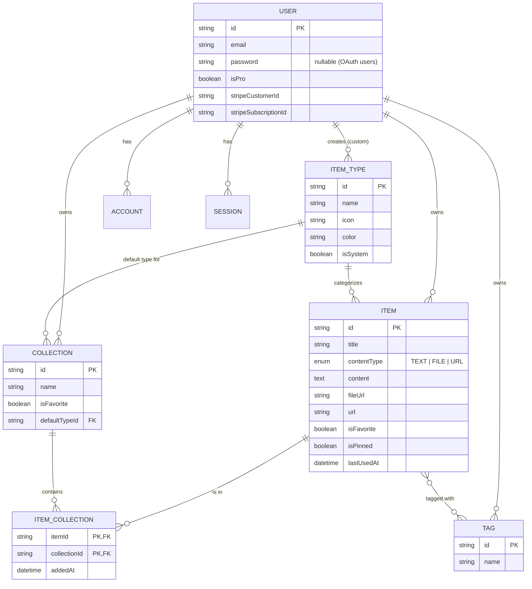
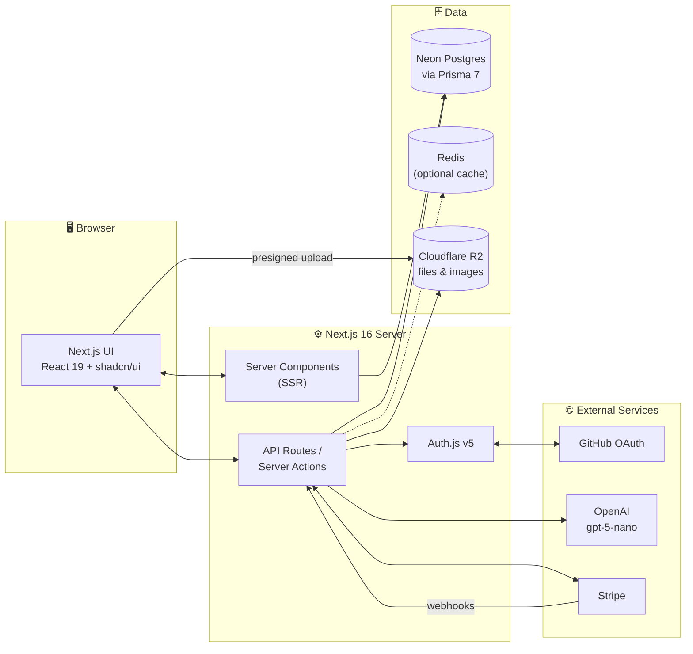
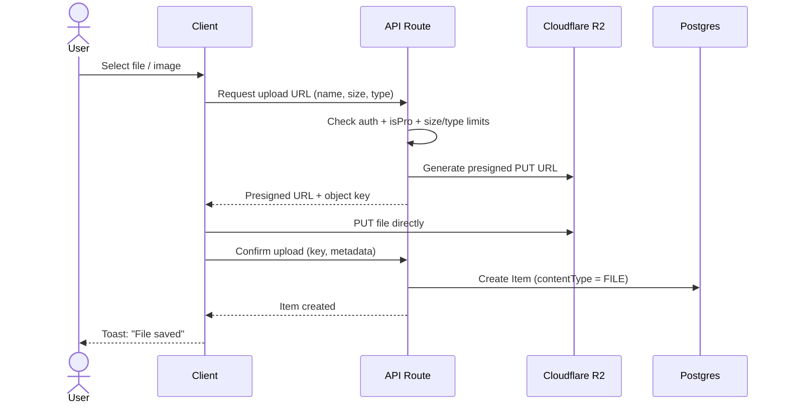
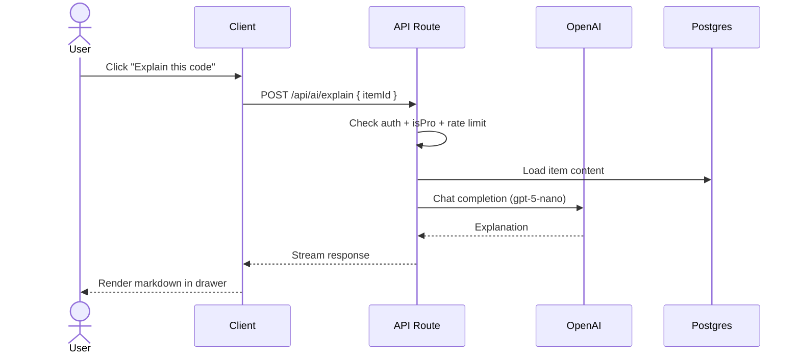
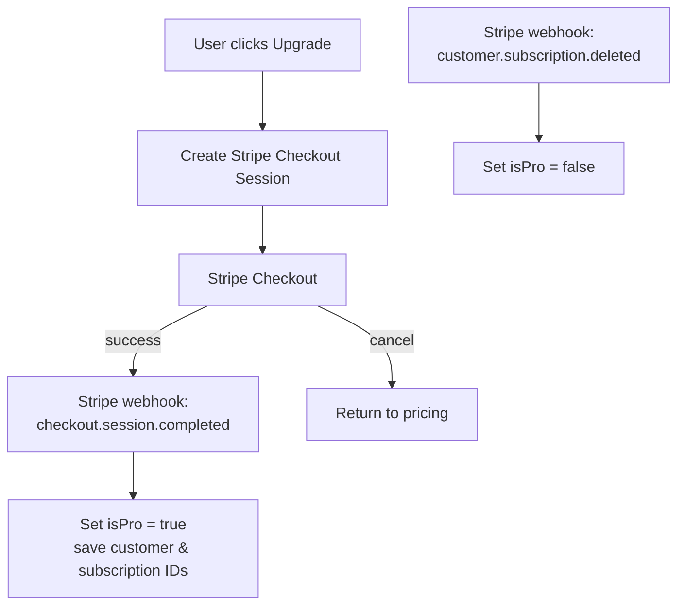
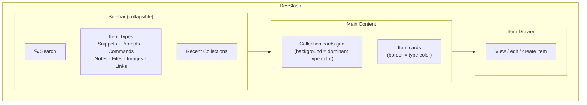

# 🗃️ DevStash — Project Overview

> **One fast, searchable, AI-enhanced hub for all your dev knowledge & resources.**

|            |                                                                                                                               |
| ---------- | ----------------------------------------------------------------------------------------------------------------------------- |
| **Status** | Planning                                                                                                                      |
| **Type**   | SaaS (freemium)                                                                                                               |
| **Stack**  | Next.js 16 · React 19 · TypeScript · Prisma 7 · Neon Postgres · Auth.js v5 · Tailwind v4 · shadcn/ui · Cloudflare R2 · OpenAI |

---

## Table of Contents

1. [Problem](#1-problem)
2. [Target Users](#2-target-users)
3. [Features](#3-features)
4. [Data Model](#4-data-model)
5. [Tech Stack & Architecture](#5-tech-stack--architecture)
6. [Monetization](#6-monetization)
7. [UI / UX](#7-ui--ux)
8. [Routes](#8-routes)
9. [Development Rules](#9-development-rules)
10. [Open Questions](#10-open-questions)
11. [Resources & Links](#11-resources--links)

---

## 1. Problem

Developers keep their essentials scattered across many tools:

| What              | Where it usually lives    |
| ----------------- | ------------------------- |
| Code snippets     | VS Code, Notion           |
| AI prompts        | Old chat threads          |
| Context files     | Buried in project folders |
| Useful links      | Browser bookmarks         |
| Docs              | Random folders            |
| Commands          | `.txt` files              |
| Project templates | GitHub Gists              |
| Terminal commands | Bash history              |

**Result:** context switching, lost knowledge, and inconsistent workflows.

**Solution:** DevStash gives developers **one** fast, searchable, AI-enhanced place for all of it.

---

## 2. Target Users

| Persona                           | Primary need                                           |
| --------------------------------- | ------------------------------------------------------ |
| 🧑‍💻 **Everyday Developer**         | Quickly grab snippets, prompts, commands, and links    |
| 🤖 **AI-first Developer**         | Save prompts, contexts, workflows, and system messages |
| 🎓 **Content Creator / Educator** | Store code blocks, explanations, and course notes      |
| 🏗️ **Full-stack Builder**         | Collect patterns, boilerplates, and API examples       |

---

## 3. Features

### A. Items & Item Types

Every item has a **type**. DevStash ships with fixed **system types** that users cannot edit or delete. Users can add **custom types** later (Pro).

| Type    | Content kind | Plan    | Route             |
| ------- | ------------ | ------- | ----------------- |
| Snippet | Text         | Free    | `/items/snippets` |
| Prompt  | Text         | Free    | `/items/prompts`  |
| Note    | Text         | Free    | `/items/notes`    |
| Command | Text         | Free    | `/items/commands` |
| Link    | URL          | Free    | `/items/links`    |
| File    | File         | **Pro** | `/items/files`    |
| Image   | File         | **Pro** | `/items/images`   |

- **Content kinds:** `TEXT` (snippet, prompt, note, command), `URL` (link), `FILE` (file, image)
- Items open and are created in a **quick-access drawer**, not a separate page

### B. Collections

- A collection can hold items of **any type**
- An item can belong to **multiple collections** (many-to-many)
  - e.g. a React snippet lives in both _React Patterns_ and _Interview Prep_
- Examples:
  - **React Patterns** (snippets, notes)
  - **Context Files** (files)
  - **Python Snippets** (snippets)

### C. Search

Search across:

- Titles
- Content
- Tags
- Types

> 💡 Start with Postgres full-text search (`tsvector` + GIN index) or trigram matching (`pg_trgm`). That is "basic search" for the Free tier; Pro could add semantic/vector search later (see [Open Questions](#10-open-questions)).

### D. Authentication

- Email + password (Credentials provider)
- GitHub OAuth

### E. Core Features

- ⭐ Favorite collections and items
- 📌 Pin items to the top
- 🕒 Recently used items
- 📥 Import code from a file
- 📝 Markdown editor for text types
- 📤 File upload for file types (file / image)
- 📦 Export data (JSON / ZIP)
- 🌙 Dark mode by default (light mode optional)
- 🔗 Add/remove an item to/from multiple collections
- 👀 See which collections an item belongs to

### F. AI Features (Pro only)

Powered by **OpenAI `gpt-5-nano`**.

| Feature                 | Description                                       |
| ----------------------- | ------------------------------------------------- |
| 🏷️ Auto-tag suggestions | Suggest tags from item content                    |
| 📄 Summaries            | Short summary of long notes, files, or prompts    |
| 🧠 Explain This Code    | Plain-English explanation of a snippet            |
| ✨ Prompt Optimizer     | Rewrite a prompt to be clearer and more effective |

---

## 4. Data Model

### Entity Relationship Diagram



### Prisma Schema

> ⚠️ **ROUGH DRAFT.** This is a starting point, not a final schema. Expect changes once implementation starts. Check it against the [Prisma 7 docs](https://www.prisma.io/docs) before the first migration.

```prisma
// prisma/schema.prisma — ROUGH DRAFT

generator client {
  provider = "prisma-client"            // Prisma 7 generator
  output   = "../src/generated/prisma"
}

datasource db {
  provider = "postgresql"
  // Prisma 7: connection URL is configured in prisma.config.ts,
  // and the Neon driver adapter (@prisma/adapter-neon) is passed to PrismaClient.
}

// ─────────────────────────────────────────────
// Enums
// ─────────────────────────────────────────────

enum ContentType {
  TEXT   // snippet, prompt, note, command
  FILE   // file, image
  URL    // link
}

// ─────────────────────────────────────────────
// Auth (Auth.js / NextAuth v5 Prisma adapter models)
// ─────────────────────────────────────────────

model User {
  id                   String    @id @default(cuid())
  name                 String?
  email                String    @unique
  emailVerified        DateTime?
  image                String?
  password             String?   // hashed (bcrypt/argon2); null for OAuth-only users

  // Billing
  isPro                Boolean   @default(false)
  stripeCustomerId     String?   @unique
  stripeSubscriptionId String?   @unique

  createdAt            DateTime  @default(now())
  updatedAt            DateTime  @updatedAt

  accounts             Account[]
  sessions             Session[]
  items                Item[]
  itemTypes            ItemType[]
  collections          Collection[]
  tags                 Tag[]
}

model Account {
  id                String  @id @default(cuid())
  userId            String
  type              String
  provider          String
  providerAccountId String
  refresh_token     String? @db.Text
  access_token      String? @db.Text
  expires_at        Int?
  token_type        String?
  scope             String?
  id_token          String? @db.Text
  session_state     String?

  user User @relation(fields: [userId], references: [id], onDelete: Cascade)

  @@unique([provider, providerAccountId])
}

model Session {
  id           String   @id @default(cuid())
  sessionToken String   @unique
  userId       String
  expires      DateTime

  user User @relation(fields: [userId], references: [id], onDelete: Cascade)
}

model VerificationToken {
  identifier String
  token      String   @unique
  expires    DateTime

  @@unique([identifier, token])
}

// ─────────────────────────────────────────────
// App models
// ─────────────────────────────────────────────

model Item {
  id          String      @id @default(cuid())
  title       String
  description String?
  contentType ContentType

  // TEXT
  content     String?     @db.Text
  language    String?     // optional, for syntax highlighting

  // FILE (Cloudflare R2)
  fileUrl     String?
  fileName    String?
  fileSize    Int?        // bytes
  mimeType    String?

  // URL
  url         String?

  isFavorite  Boolean     @default(false)
  isPinned    Boolean     @default(false)
  lastUsedAt  DateTime?   // powers "Recently used"

  createdAt   DateTime    @default(now())
  updatedAt   DateTime    @updatedAt

  userId      String
  user        User        @relation(fields: [userId], references: [id], onDelete: Cascade)

  itemTypeId  String
  itemType    ItemType    @relation(fields: [itemTypeId], references: [id])

  tags        Tag[]       // implicit many-to-many
  collections ItemCollection[]

  @@index([userId, itemTypeId])
  @@index([userId, isPinned])
  @@index([userId, lastUsedAt])
}

model ItemType {
  id          String       @id @default(cuid())
  name        String       // "snippet", "prompt", ...
  slug        String       // used in URLs: /items/snippets
  icon        String       // Lucide icon name, e.g. "Code"
  color       String       // hex, e.g. "#3b82f6"
  isSystem    Boolean      @default(false)

  userId      String?      // null for system types
  user        User?        @relation(fields: [userId], references: [id], onDelete: Cascade)

  items       Item[]
  collections Collection[] @relation("CollectionDefaultType")

  @@unique([userId, slug])
}

model Collection {
  id            String    @id @default(cuid())
  name          String
  description   String?
  isFavorite    Boolean   @default(false)

  defaultTypeId String?   // used for new/empty collections
  defaultType   ItemType? @relation("CollectionDefaultType", fields: [defaultTypeId], references: [id])

  createdAt     DateTime  @default(now())
  updatedAt     DateTime  @updatedAt

  userId        String
  user          User      @relation(fields: [userId], references: [id], onDelete: Cascade)

  items         ItemCollection[]

  @@index([userId])
}

model ItemCollection {
  itemId       String
  collectionId String
  addedAt      DateTime   @default(now())

  item         Item       @relation(fields: [itemId], references: [id], onDelete: Cascade)
  collection   Collection @relation(fields: [collectionId], references: [id], onDelete: Cascade)

  @@id([itemId, collectionId])
  @@index([collectionId])
}

model Tag {
  id     String @id @default(cuid())
  name   String

  userId String
  user   User   @relation(fields: [userId], references: [id], onDelete: Cascade)

  items  Item[]

  @@unique([userId, name])
}
```

### Data model notes & changes from the original notes

- **`contentType`** is now an enum with three values (`TEXT | FILE | URL`) so links have their own kind instead of being lumped in with text.
- **Tags are scoped per user** (`@@unique([userId, name])`), so users don't share or collide on tag names.
- **Item ↔ Tag** is an implicit many-to-many. Switch to an explicit join table if you need metadata (e.g. "AI-suggested" vs "user-added").
- **`password`** was added to `User` for the Credentials provider. Note that Auth.js Credentials requires the **JWT session strategy**, so the `Session` table may go unused.
- **`lastUsedAt`** on `Item` powers "Recently used".
- **`slug`** on `ItemType` powers clean URLs (`/items/snippets`).
- **`mimeType`** was added for file/image previews.
- **Collection color** is **derived**, not stored: it's the color of the type the collection holds the most of, falling back to `defaultType`.
- **System types** are seeded with `userId = null` and `isSystem = true` (see seed data below).

### System type seed data

```ts
// prisma/seed.ts — ROUGH DRAFT
const systemTypes = [
	{ name: 'snippet', slug: 'snippets', icon: 'Code', color: '#3b82f6' },
	{ name: 'prompt', slug: 'prompts', icon: 'Sparkles', color: '#8b5cf6' },
	{ name: 'command', slug: 'commands', icon: 'Terminal', color: '#f97316' },
	{ name: 'note', slug: 'notes', icon: 'StickyNote', color: '#fde047' },
	{ name: 'file', slug: 'files', icon: 'File', color: '#6b7280' },
	{ name: 'image', slug: 'images', icon: 'Image', color: '#ec4899' },
	{ name: 'link', slug: 'links', icon: 'Link', color: '#10b981' },
];
```

---

## 5. Tech Stack & Architecture

### Stack

| Layer        | Choice                                     | Notes                                    |
| ------------ | ------------------------------------------ | ---------------------------------------- |
| Framework    | **Next.js 16** (App Router) + **React 19** | SSR pages with dynamic client components |
| Language     | **TypeScript**                             | End-to-end type safety                   |
| Backend      | Next.js **API routes / Server Actions**    | Items CRUD, file uploads, AI calls       |
| Database     | **Neon** (serverless PostgreSQL)           |                                          |
| ORM          | **Prisma 7**                               | Neon driver adapter; migrations only     |
| Cache        | **Redis** _(maybe)_                        | e.g. Upstash, for caching or rate limits |
| File storage | **Cloudflare R2**                          | S3-compatible; presigned uploads         |
| Auth         | **Auth.js (NextAuth) v5**                  | Credentials + GitHub OAuth               |
| AI           | **OpenAI `gpt-5-nano`**                    | Pro-only features                        |
| Payments     | **Stripe**                                 | Subscriptions + webhooks                 |
| Styling      | **Tailwind CSS v4** + **shadcn/ui**        | Lucide icons                             |
| Repo         | Single codebase                            | Less overhead                            |

### System Architecture



### File Upload Flow (Pro)



### AI Feature Flow (Pro)



### Suggested Project Structure

```
devstash/
├── prisma/
│   ├── schema.prisma
│   ├── migrations/
│   └── seed.ts
├── prisma.config.ts
├── src/
│   ├── app/
│   │   ├── (auth)/              # sign-in, sign-up
│   │   ├── (dashboard)/
│   │   │   ├── page.tsx         # collections grid
│   │   │   ├── items/[type]/    # /items/snippets, etc.
│   │   │   └── collections/[id]/
│   │   └── api/
│   │       ├── auth/[...nextauth]/
│   │       ├── items/
│   │       ├── collections/
│   │       ├── upload/
│   │       ├── ai/
│   │       └── webhooks/stripe/
│   ├── components/
│   │   ├── ui/                  # shadcn/ui
│   │   ├── items/               # item cards, drawer, editor
│   │   ├── collections/
│   │   └── layout/              # sidebar, header
│   ├── lib/
│   │   ├── prisma.ts
│   │   ├── auth.ts
│   │   ├── r2.ts
│   │   ├── openai.ts
│   │   ├── stripe.ts
│   │   └── limits.ts            # free/pro gating
│   ├── generated/prisma/        # Prisma client output
│   └── types/
└── .env
```

### Environment Variables (draft)

```bash
# Database
DATABASE_URL=

# Auth.js
AUTH_SECRET=
AUTH_GITHUB_ID=
AUTH_GITHUB_SECRET=

# Cloudflare R2
R2_ACCOUNT_ID=
R2_ACCESS_KEY_ID=
R2_SECRET_ACCESS_KEY=
R2_BUCKET_NAME=
R2_PUBLIC_URL=

# OpenAI
OPENAI_API_KEY=

# Stripe
STRIPE_SECRET_KEY=
STRIPE_WEBHOOK_SECRET=
STRIPE_PRICE_MONTHLY=
STRIPE_PRICE_YEARLY=

# Redis (optional)
REDIS_URL=
```

---

## 6. Monetization

Freemium model.

| Feature                                             |   Free   |                Pro                |
| --------------------------------------------------- | :------: | :-------------------------------: |
| **Price**                                           |    $0    | **$8/mo** or **$72/yr** (25% off) |
| Items                                               | 50 total |             Unlimited             |
| Collections                                         |    3     |             Unlimited             |
| System types (snippet, prompt, note, command, link) |    ✅    |                ✅                 |
| File & image uploads                                |    ❌    |                ✅                 |
| Custom types _(coming later)_                       |    ❌    |                ✅                 |
| Search                                              |  Basic   |      Basic _(advanced TBD)_       |
| AI auto-tagging                                     |    ❌    |                ✅                 |
| AI summaries                                        |    ❌    |                ✅                 |
| AI code explanation                                 |    ❌    |                ✅                 |
| AI prompt optimizer                                 |    ❌    |                ✅                 |
| Export data (JSON / ZIP)                            |    ❌    |                ✅                 |
| Priority support                                    |    ❌    |                ✅                 |

> 🛠️ **Development mode:** build the Pro gating foundation now (`isPro`, Stripe fields, a central `limits.ts` helper), but **let all users access everything during development**, e.g. behind a `FEATURE_GATING_ENABLED=false` flag.

### Subscription Flow



---

## 7. UI / UX

### Design Principles

- Modern, minimal, developer-focused
- **Dark mode by default**, light mode optional
- Clean typography, generous whitespace
- Subtle borders and shadows
- Syntax highlighting for code blocks
- **References:** [Notion](https://www.notion.so), [Linear](https://linear.app), [Raycast](https://www.raycast.com)

## **Design Reference**

See `@context/screenshots/Dashboard.png` for the main dashboarddesign. It does not have to be pixel perfect. Use it as a base.

### Layout



- **Sidebar:** item types (linking to `/items/<type>`) and latest collections
- **Main:** grid of collection cards, **background color-coded** by the type each collection holds most. Items appear below in cards with a **type-colored border**.
- **Drawer:** items open in a quick-access drawer for viewing, editing, and creating

### Type Colors & Icons

Icons come from [Lucide](https://lucide.dev/icons), the default icon set for shadcn/ui (`lucide-react`).

| Type    | Color      | Hex       | Lucide Icon                                          |
| ------- | ---------- | --------- | ---------------------------------------------------- |
| Snippet | 🔵 Blue    | `#3b82f6` | [`Code`](https://lucide.dev/icons/code)              |
| Prompt  | 🟣 Purple  | `#8b5cf6` | [`Sparkles`](https://lucide.dev/icons/sparkles)      |
| Command | 🟠 Orange  | `#f97316` | [`Terminal`](https://lucide.dev/icons/terminal)      |
| Note    | 🟡 Yellow  | `#fde047` | [`StickyNote`](https://lucide.dev/icons/sticky-note) |
| File    | ⚪ Gray    | `#6b7280` | [`File`](https://lucide.dev/icons/file)              |
| Image   | 🩷 Pink    | `#ec4899` | [`Image`](https://lucide.dev/icons/image)            |
| Link    | 🟢 Emerald | `#10b981` | [`Link`](https://lucide.dev/icons/link)              |

```tsx
import {
	Code,
	Sparkles,
	Terminal,
	StickyNote,
	File,
	Image,
	Link,
} from 'lucide-react';
```

> 💡 These colors match Tailwind's palette (`blue-500`, `violet-500`, `orange-500`, `yellow-300`, `gray-500`, `pink-500`, `emerald-500`). Yellow `#fde047` is light, so use dark text on it.

### Responsive

- Desktop-first, but usable on mobile
- Sidebar becomes a drawer on mobile

### Micro-interactions

- Smooth transitions
- Hover states on cards
- Toast notifications for actions (shadcn [Sonner](https://ui.shadcn.com/docs/components/sonner))
- Loading skeletons

### Suggested UI libraries

| Need                     | Option                                                                                                               |
| ------------------------ | -------------------------------------------------------------------------------------------------------------------- |
| Syntax highlighting      | [Shiki](https://shiki.style)                                                                                         |
| Code editor              | [CodeMirror](https://codemirror.net) or [Monaco](https://microsoft.github.io/monaco-editor/)                         |
| Markdown editor/render   | [react-markdown](https://github.com/remarkjs/react-markdown), [MDXEditor](https://mdxeditor.dev)                     |
| Command palette / search | shadcn [Command](https://ui.shadcn.com/docs/components/command) (cmdk)                                               |
| Drawer                   | shadcn [Sheet](https://ui.shadcn.com/docs/components/sheet) / [Drawer](https://ui.shadcn.com/docs/components/drawer) |
| Theme switching          | [next-themes](https://github.com/pacocoursey/next-themes)                                                            |

---

## 8. Routes

| Route                  | Purpose                                     |
| ---------------------- | ------------------------------------------- |
| `/`                    | Marketing / landing page                    |
| `/sign-in`, `/sign-up` | Authentication                              |
| `/dashboard`           | Collections grid + pinned/recent items      |
| `/items/[type]`        | All items of a type, e.g. `/items/snippets` |
| `/collections/[id]`    | Single collection                           |
| `/favorites`           | Favorite items & collections                |
| `/settings`            | Profile, theme, export, billing             |
| `/pricing`             | Plans & upgrade                             |

---

## 9. Development Rules

> 🚫 **NEVER use `prisma db push` or change the database structure directly.**
> All schema changes go through migrations, run in **dev** first and then in **prod**.

```bash
# Development: create & apply a migration
npx prisma migrate dev --name <descriptive_name>

# Production: apply pending migrations
npx prisma migrate deploy
```

Other conventions:

- Use **Neon branches** for dev/preview databases so prod data is never touched
- Keep all Free/Pro checks in one place (`lib/limits.ts`)
- Validate all input with a schema library (e.g. [Zod](https://zod.dev))
- Rate-limit AI endpoints, even for Pro users

---

## 10. Open Questions

- [ ] **Search:** is Postgres full-text enough, or add semantic/vector search (`pgvector`) as a Pro feature?
- [ ] **Redis:** needed at launch, or only for rate limiting later?
- [ ] **Downgrades:** what happens to a user's 200 items or uploaded files when Pro lapses? (Read-only over the limit?)
- [ ] **File limits:** max file size and total storage per Pro user?
- [ ] **AI usage:** monthly cap per Pro user to control OpenAI costs?
- [ ] **Custom types:** timeline and limits (how many per user)?
- [ ] **Sharing:** public/shareable collections or items in a future version?
- [ ] **Import:** beyond single files, support imports from GitHub Gists or browser bookmarks?
- [ ] **Item versioning:** keep edit history for snippets and prompts?

---

## 11. Resources & Links

| Tool                   | Docs                                                   |
| ---------------------- | ------------------------------------------------------ |
| Next.js                | https://nextjs.org/docs                                |
| React                  | https://react.dev                                      |
| TypeScript             | https://www.typescriptlang.org/docs                    |
| Prisma                 | https://www.prisma.io/docs                             |
| Prisma + Neon          | https://www.prisma.io/docs/orm/overview/databases/neon |
| Neon                   | https://neon.com/docs                                  |
| Auth.js (NextAuth v5)  | https://authjs.dev                                     |
| Auth.js Prisma Adapter | https://authjs.dev/getting-started/adapters/prisma     |
| Cloudflare R2          | https://developers.cloudflare.com/r2                   |
| OpenAI API             | https://platform.openai.com/docs                       |
| Stripe Subscriptions   | https://docs.stripe.com/billing/subscriptions/overview |
| Tailwind CSS v4        | https://tailwindcss.com/docs                           |
| shadcn/ui              | https://ui.shadcn.com                                  |
| Lucide Icons           | https://lucide.dev                                     |
| Upstash Redis          | https://upstash.com/docs/redis                         |
